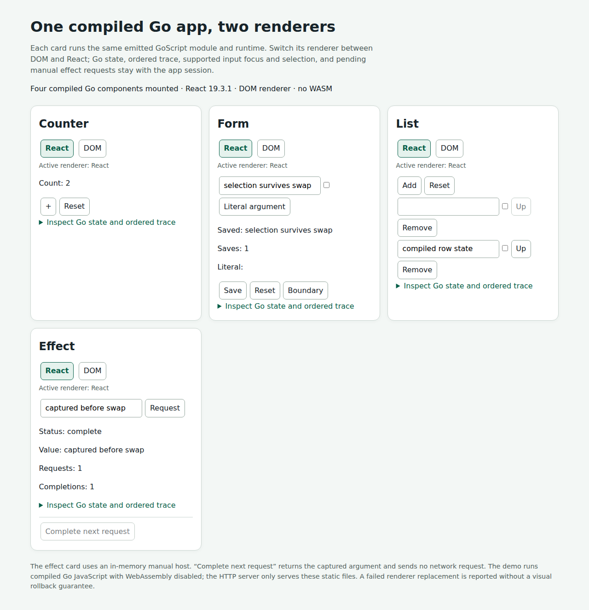

# Compiled DOM/React backend CI evidence — 2026-10-31 UTC

The original Go counter, controlled form, keyed list and deterministic effect now execute one compiled GoScript module per application through React or a standalone DOM renderer. Replacement keeps application state, cached Go View, dispatch order, focus/selection and pending effect correlation without calling application Init/Update/View again. The runtime, renderers and native comparison harness form one composed milestone; no JavaScript application reducer or WASM substitutes for Go application execution.

Tested source: `195c9433179218348d4b9f2477ae1e0725337d15`, tree `c0e4a66eee3fdd8b789e1b565167856fdab62433`, direct parent `832d21262ce5dd3bd1d308a19bd8d7a422f6d7cb`. PR #12 targets PR #11/base `184ccdaabe9e6e46e1052ee79cd7e0be26fe3281`. Local repair alias `27a2aa7aee73839c26ec4c21e22f125b7431e8e8` has the same exact tree and parent. Source and synthetic PR merge identities are separate; see [source-checkpoints.json](source-checkpoints.json).

## Executed primary run

[Full push run 41155530877](https://github.com/samuelpmahan/gondola/actions/runs/41155530877), job 124401386239, checked out source 195 directly and completed successfully. It was the first successful full current-head run, so its verified artifact became the primary audit input while the PR runs continued. This replaces the earlier planned PR artifact explicitly; a push result does not establish another run's result. [Primary provenance](primary-provenance.json), [run metadata](primary-run.json), [job metadata](primary-jobs.json), and [decoded raw job log](logs/124401386239.log) retain that distinction.

The PR runner uses synthetic merge `ce26da0cb62e4ba3fd1ddd2c2f2456c42969b131`, tree c0e4a66, parents 184cc/195c943. Completed PR raw logs independently show that checkout; the API head_sha names195. The final [workflow snapshot](runs-source195-final.json) and [status proof](status.json) record **24/24 successful workflows: 12 PR and 12 push**, all on source 195. Detailed decoded logs cover all 12 PR runs and the primary push; other push runs are retained as final status records. The final [recursive acceptance proof](coordination/acceptance.json) closes all 20 CI packets and their amendment chains.

| Current primary gate | Executed result |
| --- | --- |
| Default runner | Full mode; 18 successful outer commands, including the inherited full runner |
| Compiler regression |33 successful commands; 97/97 Node tests; root/compiler Go test, race and vet; 5 scripts,43 ticks,89 detected mutation controls,0 mismatches |
| Dual build |4 applications; 209 outputs each; 204 companion files byte-identical; separate raw bundle hashes |
| Backend matrix |Counter/form/list/effect/list-growth; 43 logical fixture ticks across React-only, DOM-only, and alternating profiles; 37 swaps,9 focused swaps,45 detected mutation controls; all matched |
| HTTP demonstration |5 checks passed; 4 cards; state, focus/backward selection, retired callback fencing, pending effect; no page errors or WASM requests |
| Browser selection |Both CHROMIUM_PATH and CHROMIUM_EXECUTABLE_PATH unset; managed Chromium 156.0.8078.4 |
| Source stability |122 compiler and126 composed source pins match before/after; 209 output hashes per backend match after resolving their different path bases |

Readable exact receipts: [compiled backend execution](reports/compiled-backends-execution.json), [compiler execution](reports/compiled-frontend-execution.json), [HTTP smoke](reports/demo-smoke.json). Commands, arguments, environment overrides, timing, versions and log digests are preserved inside them. Current versions are root Go 1.24.13/compiler Go 1.27.3, Node 22.23.4, React/ReactDOM 19.3.1, esbuild 0.28.2, Playwright 1.64.1, Chromium 156.0.8078.4. GoScript is pinned v0.6.2 (`d8f58a091947cff26a9171be7bd130892b0afad3`).



## Static and inherited evidence

The full inherited chain reran Milestone 0: 5,000 cases, seed 20261030,59 executable compatibility rules, receipt match and all 24 original SHA-256 checks. The original counter, Gobi types and receipts remain unchanged; source comparison verifies 1,251 preexisting tracked paths outside compiled-frontend against the PR #11 baseline.

A separate successful current-head [typed composition PR run 41155534348](https://github.com/samuelpmahan/gondola/actions/runs/41155534348) produced 63 scripts,2,463 actions/native frames,4,926 actor comparisons,0 mismatches; seeds20261030/20261031,30 cases per seed, max40 actions. Its [aggregate report](typed-source195/selected/typed-composition/build/report.json), [manifest](typed-source195/selected/typed-composition/build/report-manifest.json), selected inherited reports and exact retention boundary are retained. The separately named focus-negative control intentionally contains mismatches; it is not a positive replay failure.

The typed provider ZIP is120,564,373 bytes, SHA`eda966eb257998dd01c350e76375b216c1b9c7e69bf6a222057bae58ebe8b23e`,2,372 members/3,298,153,070 uncompressed bytes. Nine selected files/553,021 bytes and the complete ZIP inventory are Git-retained. The full 3.3 GB inherited traces and original ZIP are not retained in Git; the provider artifact expires at the exact date in [its metadata](typed-source195/artifact.json). Reproduce those traces from the retained commands/seeds.

Additional independently executed local checks include the 5 checker tests and 9 semantic swap probes. These are separate from the 97-test CI total; the default runner does not claim to execute every evidence/audit script.

## Restore the executable demonstration

The lossless member archive contains all 817 files from the primary provider artifact,87,153,279 uncompressed bytes. Provider ZIP 14,931,201 bytes, SHA`646f06eb972d8ab2680fa34b12bf646e0dda1d8bd31c2ae1a3df443b113c99aa`; Git-retained archive5,217,080 bytes, SHA`91b781500ff5379cf118918f545b6593969cb28d5495014b68c9a3ea6ca9218d`. Every member size/SHA was checked after archive creation. [Member index](retained-index.json),[retention proof](retention.json),[provider metadata](artifact.json),[retention helper](retain.py).

Extract into an empty review directory so fresh generated CI packets remain separate from historical source receipts:

```sh
mkdir -p /tmp/gobi-backend-review
tar -xJf compiled-backends/ci/2026-10-31/ci-artifacts.tar.xz -C /tmp/gobi-backend-review
python3 -m http.server 8080 --directory /tmp/gobi-backend-review/compiled-backends/artifacts/demo
# Open http://127.0.0.1:8080/
```

The built demo is self-contained. Its effect host is manual and deterministic, with no production HTTP service. To rebuild from a checkout of source 195:

```sh
npm ci --no-audit --no-fund
npm ci --prefix interaction --no-audit --no-fund
npm ci --prefix compiled-frontend --no-audit --no-fund
interaction/node_modules/.bin/playwright install --with-deps chromium
bash run-compiled-backends.sh
```

`--backends-only` is explicitly partial. The full command executes inherited gates before compiler/backend builds and browser checks. The primary archive retains all new compiler/backend raw traces and generated code; it does not imply retention of every inherited intermediate.

## Failure history and independent acceptance

Initial source 832 passed configured local runs but two new browser test hooks hardcoded/tmp/chromium. Its actual CI finished20 workflows successful/4 failed; 97 Node tests included92 pass and5 failures (four DOM tests and one React browser test), all missing that executable. The compiled-backends path stopped in its inherited runner before its application matrix. The [complete failed artifact](initial-source832/source.zip),38 member index, raw logs and source-specific status snapshot are preserved. ZIP 65,988 bytes, SHA`e78cfe71bcf0f77180d03a9ac2a3cd3ee5afcf9d7df7834aab097e56ef3362fc`.

The repaired source only changes those launchers to reuse the existing managed/configured helper, plus historical-scope documentation. Assertions, Go applications, runtime, renderers, harness and oracle are unchanged. Author and independent reviewer each passed4 DOM+1 React browser+2 launcher-option tests locally. Local managed Chromium was unavailable; the current full CI bundle supplies the actual unset-path launch evidence. Initial DELIVERY and local archive remain source 832 history, not rewritten current-source proof. The source 195 PORTABLE-BROWSER-REPAIR note is a contemporaneous pre-run snapshot; this dated evidence closes its pending managed-browser gate without changing the tested source.

The source milestone has 26 closed packets / 15 native epochs. CI coordination uses the same unmodified Rebalancer 1.0.4 probe, toolkit PR1 head`989c295717511c812b69beda5d125817ffc054c9`, SHA`5fa75295203944df8b7e2112dbd900b9c89255209a1ac92d61c01bf035d8066c`. Six actual Luna 6 XHigh child workers filled the six available child slots (seven including root). Native allocation is separate from successful platform calls; dependency gates and actual deliveries are retained in coordination/. The CI phase closes 20 packets across 12 native epochs, with zero broken constraints, equal native/exact scores, and independent capacity/eligibility checks. Every author packet has a different reviewer; the final recursive proof includes all metadata repair chains.

Original amend/not_reuse/insufficient_evidence packets remain visible. One relocated CI packet retained old path labels; another interim build receipt had a mistyped backend.go pin. Corrected canonical mappings and computed hashes belong to new repair/final packets, with independent review. Some authoring drafts are known only by observed hashes; consumed packets and correction history are retained. Earlier local failures and the explicitly unavailable demo-attempt01 artifacts remain documented in the source 832 RESULTS; they are not presented as passes.

## Demonstrated boundary and next milestone

The finite serialized synchronous Chromium profiles establish native-Go versus emitted-JavaScript state/tree/binding equivalence and mounted DOM/live-property behavior across React, DOM and renderer swaps. They cover disabled controls, keyed identity, focus/backward selection, dispatch/effect ordering, pending requests, duplicate/callback fencing and physical teardown. One concrete emitted module per application is reused by both renderers. Separate build-directory raw bundles differ and are not normalized to claim byte equivalence.

Retired renderer callback fencing is observed separately from an active missing-target driver attempt. Actual retained native DOM listener invocation remains untested. Other engines, IME, hydration, pixels, concurrent React, arbitrary Go/libraries/initializers, Float64Array GoSlice wrappers, production transport and committed-state rollback remain outside the guarantee. A screenshot is demonstration evidence, not pixel-equivalence proof.

Another frontend must implement the documented synchronous renderer/binding/lifetime/focus protocol and pass the same native/reference/oracle and mutation matrix while consuming the same Go module/View. The next composed milestone is compiling the existing typed parent/child and session ownership contracts through both renderers, including nested lifecycle and subtree effect cancellation, without moving application decisions into JavaScript.

No main merge or production deployment.
