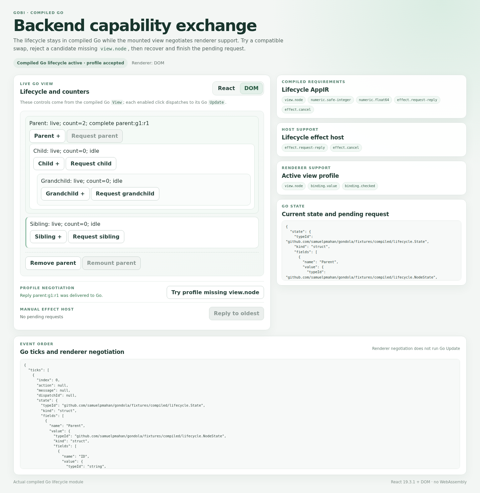

# Compiled backend capability negotiation: evidence and replay

The reviewed source is `60b5aeff3172837ad7831c2b78b210454a3d81a2`, tree `cc3a129b4372d00d5168135aa2e5687dfbf6788f`, parent `a2e1164d68abaaa7d028bdaf6a20bea842a131ae`. [PR #15](https://github.com/samuelpmahan/gondola/pull/15) stacks on the unmerged lifecycle PR #14. No main merge or production deployment was performed.

The Go compiler declares admitted cancellation requirements. The effect host and renderers declare support in separate closed profiles. Admission happens before Go Init and before retiring the live renderer. A rejected replacement leaves the existing session, DOM, callbacks, and pending work usable; compatible React/DOM replacements continue the same Go state.

## Authoritative result

**All 30 exact-source CI workflows and jobs passed** (15 push, 15 PR). The authoritative fresh full execution is [push run 41193504188](https://github.com/samuelpmahan/gondola/actions/runs/41193504188), job 124514913013, artifact 13040129310. Independent checks validated the provider ZIP, all 1,476 ZIP members, the 189-file inner archive, final receipt, manifest, immutable snapshot, source pins, and command outcomes. The default full command ran 17 successful commands through 12 stages, including the complete inherited chain.

[Final closure](FINAL-ACCEPTANCE.json), [acceptance policy](ACCEPTANCE-SCOPE.json), and the [terminal source/job catalog](source-60b5aef/custody/provider/source-60b5aeff-terminal-runs-jobs-20261031T111444Z-v2.json) distinguish source acceptance from rejected historical/local containers.

| Check | Observed result |
| --- | --- |
| M0 static parity | 5,000 cases, seed `20261030`; 59 executable rule rows; original receipts unchanged; all 24 checksum entries pass |
| Original counter interaction | 107 scripts / 4,473 initial-and-action ticks; native comparator matched |
| Compiled lifecycle | 26 matched ticks, 17 swaps, seven requests, three child-first cancellations |
| New admission matrix | 19 actual module-hosted rejection cases; Go methods and renderer calls remain zero before admission |
| Active negotiation trace | Five ticks; rejected and compatible swaps preserve raw state/view/DOM/pending values; old callback fences and correlated reply checks pass |
| Checker controls | Nine new capture-data mutations plus eight inherited controls detected; these are expected negative controls |
| HTTP demonstration | Eight checks pass; disabled action suppression, compatible swap, rejected profile, recovery, and reply delivery |
| Build contracts | 67 outputs per backend; AppIR and encoder identical across backends and local/hosted runs |
| Cross-environment output | 65/67 file bytes match; generated module and forwarders/go.mod hashes differ with source paths and are recorded separately |
| Source stability | 163 before/after pins match; all 24 M0 entries verified |
| Functional mismatches | Zero unexpected mismatches in the admitted fixture |

The pre-Init matrix applies conservative requirement-metadata overlays to real compiled module wrappers; the active five-tick phase uses the compiler's unmodified AppIR. The lifecycle view has no value/checked bindings, so those strict profile cases are literal/unit evidence rather than binding behavior of this Go view.

The new capability scenario and literal oracle are fixed and use no random draws. Inherited seeds, commands, versions, fixture hashes, expected negatives, and raw observations are preserved in the execution/archive and lane receipts.

## Reproduce the full experiment

Use Go 1.24, Node 22, and the existing lockfiles. The compiler module uses Go 1.27.3. CI installs the existing three npm lockfiles and Playwright Chromium; no new npm dependencies were added.

```sh
git checkout 60b5aeff3172837ad7831c2b78b210454a3d81a2
bash run-compiled-capabilities.sh
```

The local invocation also used `GOTOOLCHAIN=local GOFLAGS=-buildvcs=false GONDOLA_SKIP_NPM_CI=1 GONDOLA_SKIP_BROWSER_INSTALL=1 CHROMIUM_PATH=/tmp/chromium CHROMIUM_EXECUTABLE_PATH=/tmp/chromium`. It returned 0, and its semantic checks passed; its later archive integrity check failed as described below. The authoritative CI invocation is recorded unchanged in [execution.json](published/primary-ci/execution.json).

Exact authoritative scalar tool versions:

```json
{
  "node": "v22.23.4",
  "npm": "10.9.9",
  "rootGo": "go version go1.24.13 linux/amd64",
  "compiledGo": "go version go1.27.3 linux/amd64",
  "chromiumPath": "/home/runner/.cache/ms-playwright/chromium-1248/chrome-linux64/chrome",
  "chromium": "Google Chrome for Testing 156.0.8078.4"
}
```

Dependency and npm lockfile hashes, React/ReactDOM 19.3.1, Playwright, esbuild, browser version, and inherited toolchains are recorded in the full receipt.

## Restore and run the checked demonstration

The durable [delivery index](published/primary-ci/delivery.json) lists 15 ordered chunks. They reconstruct the exact independently verified CI archive: 14,960,460 bytes, SHA-256 `ba17805387c8204ef2624caec0af35641771bc8af48d4f03b82c1a6609586d8f`.

From this evidence checkout:

```sh
gobi_replay_dir=$(mktemp -d /tmp/gobi-capability-replay.XXXXXX)
cat compiled-capabilities/ci/2026-10-31/published/primary-ci/chunks/part-*.bin > "$gobi_replay_dir/replay.tar.gz"
python3 compiled-capabilities/coordination/acceptance/archive/verify_archive.py --receipt "$PWD/compiled-capabilities/ci/2026-10-31/published/primary-ci/execution.json" --archive "$gobi_replay_dir/replay.tar.gz" --manifest "$PWD/compiled-capabilities/ci/2026-10-31/published/primary-ci/archive-manifest.json" --require-complete
tar -xzf "$gobi_replay_dir/replay.tar.gz" -C "$gobi_replay_dir"
python3 -m http.server 8000 --bind 127.0.0.1 --directory "$gobi_replay_dir/demo/site"
```

Open `http://localhost:8000`. Try Add Parent and Request, change between DOM and React, reject the missing-view-capability profile, recover to DOM, and deliver the pending reply. This serves the actual compiled Go lifecycle application; it does not introduce a JavaScript application reducer. Stop the local server with Ctrl-C.



## Rejections and custody limits

The first clean-start attempt failed before tests because an attempts parent directory was absent. Its exact source bundle/log and the reviewed directory-creation repair remain recorded. The initial full `031c462`/published `a2e1164` cohort failed a prose-substring acceptance check despite passing nested receipts, and incorrectly returned exit 0. The reviewed source repair uses fresh hash-bound lifecycle/method/backend/frontend receipts and seven focused regressions, including actual Node child exit checks.

The local `103735751Z` command on current source returned 0 and recorded a full pass. A subsequent independent check found its container truncated: 12,845,056 bytes / SHA `91e3d977e8efd7ef42a37d43029997a9e2ab8db7266a88cf54d5f7cc90a64b5f`, against receipt-bound 14,983,690 bytes / SHA `1a4fd17fd4f8c2aef16aaa1ed268d253b13dd77396e6cb6da3108e2b2c3921ab`. Gzip verification fails. All 189 loose manifest members still match, totaling 90,270,286 bytes. The original receipt and archive were not rewritten. Its [rejected bytes and custody record](root-integrity-60b5/damaged-local-archive/manifest.json) are separate from the valid CI delivery.

The truncation cause is **unknown**. A separate fsynced 16 MiB witness remained intact. A second witness's observer arrived after production completed and establishes no concurrent-write result. These do not establish an environmental cause or a source fix. The corrupted local container is excluded from source acceptance; the same-source fresh complete CI archive supplies the accepted replay evidence. No regression run was skipped or reused to make that decision.

Superseded preparatory log overwrites, a truncated supplementary loose archive with verified replacement chunks, malformed catalog attempts, native receipt-schema corrections, and the custody path-citation amendment are disclosed in their original and replacement records. They are not silently relabeled as passing artifacts. The custody citation repair preserves the original closed receipt and provides a corrected copy plus independent review.

## Coordination and guarantee boundary

Six Luna 6 XHigh workers were the available maximum (seven advertised slots including the lead). Native Rebalancer 1.0.4 used the inspected toolkit probe; assignment bundles, capacity, actual spawn/start acknowledgements, dependency gates, amendments, and independent reviews are in [coordination](../../coordination). The solver recommends assignments; actual agent dispatch is recorded separately. The final independent audit reports 62 closed packets and 36 accepted solver epochs, with six actual worker spawns and zero scheduler errors. [The independent scheduler audit](../../coordination/root-checks/final-acceptance/scheduler.json) checks closure and replays weighted allocation optimality.

The demonstrated guarantee is finite synchronous native-Go/direct-GoScript/React/DOM equivalence plus the tested declared-capability admission behavior. Cancellation inference covers exact keyed typed descriptors in Update-reachable functions. It does not establish arbitrary Go/control-flow or computed protocol-field inference, or a universal Init-time inference guarantee. Pre-Init rejection applies to declared AppIR requirements. Profile declarations are backend claims, not certification or a security sandbox.

The new active trace uses programmatic clicks and records no focused control (false/false); it makes no focus-identity guarantee. The inherited form checks were rerun, but other engines, general Go, dynamic child graphs, production transport, hydration, IME, concurrent React, and pixel equivalence remain untested here.

Another frontend must implement the shared versioned module/renderer contract, explicitly declare the required view/input capabilities, pair with an effect host supporting the declared request/cancel policy, and pass the same native/tree/mounted-DOM/action-order/rejection replay. Numeric support belongs to the compiler/runtime contract, not the renderer profile.

The next composed milestone is typed keyed child collections through the compiled path: add/remove/reorder child lifetimes, pending effects, child-first cancellation and stale replies across renderer replacements. No main merge or deployment is part of this checkpoint.
