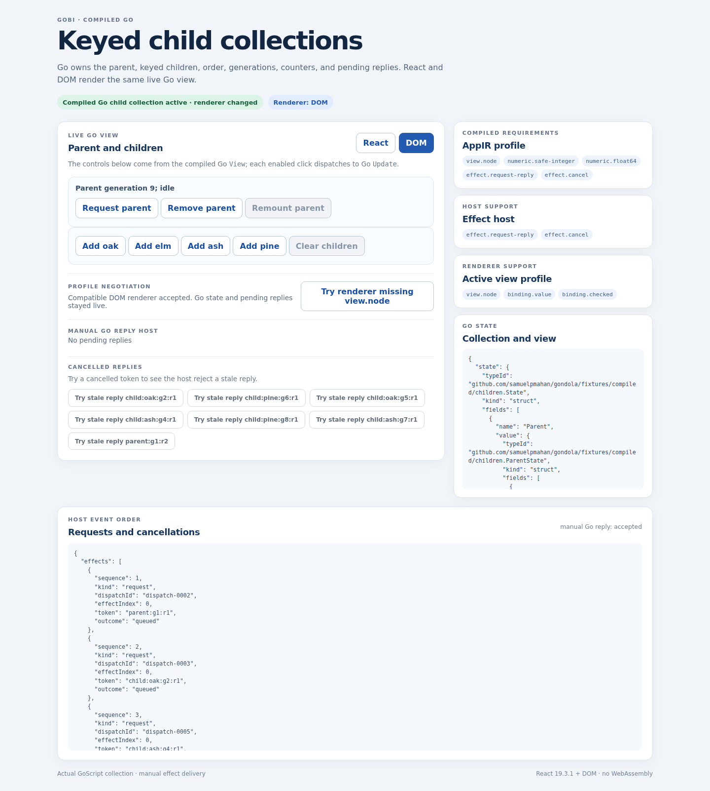

# Compiled Go keyed children: evidence and executable demo

Source: `462a9827bfe1980600456b00d0a67843eaa9756d` (tree `fdf274d81a26ce584c368f7bcdaacd837815a4ad`). Review: [PR #16](https://github.com/samuelpmahan/gondola/pull/16), based on PR #15. No main merge or production deployment.

The exact-source local full command exited 0 on 2026-10-31 at 15:06:59 UTC. All ten stages passed with no failures or semantic mismatches. The 417-member archive is 42,985,107 bytes, SHA-256 `5c70c112bd8e9e1366ff572ebde718192236409739059246a422fff52c6c1b01`. Its manifest is SHA-256 `ba2e35fc2841aaf250e5d21fdfd6b84fba02dd4f5853bd84b6e562d3f0f17f5a`. The source boundary covers 147 files. See `E-DELIVERY.json`, `E-DELIVERY.md`, `local-summary.json`, and `full-console.log`. Independent post-exit acceptance is recorded in the [final acceptance report](../../../coordination/reports/E-FINAL-ACCEPTANCE.md) and its [independent review](../../../coordination/reports/XR-FINAL-ACCEPTANCE.md). Separately, all **32/32 CI runs** (16 workflows, push and PR) succeeded on the same source commit, observed 2026-10-31 at 15:33:57 UTC. See the [final run matrix](hosted/workflow-matrix-final.json) and [hosted artifact verification](hosted/README.md). The frozen author packet records the earlier 29/3 in-progress snapshot; the final matrix supersedes that status only.

## Run the captured demo

The five files under `demo/site/` are the tested prebuilt GoScript application and its React/DOM projections. From a checkout of this evidence commit:

```sh
python3 -m http.server 8000 --directory compiled-children/ci/2026-10-31/current/demo/site
```

Open http://localhost:8000. The copied package independently passed the existing 32-check browser smoke again; [packaging result](packaged-demo-smoke.json), [exact command](packaged-demo-command.txt), and [Python HTTP asset check](python-http-serving-check.json) are recorded separately from the original full archive. The copied package independently passed the existing 32-check browser smoke again; [packaging result](packaged-demo-smoke.json), [exact command](packaged-demo-command.txt), and [Python HTTP asset check](python-http-serving-check.json) are recorded separately from the original full archive. Add/remove/reorder child counters, request and manually deliver replies, clear children, remove/remount the parent, and change renderers or reject an incompatible candidate. Go owns application state and View; the host owns transport/correlation and renderer mechanics. The screenshot records the smoke test's final empty collection after remount; a fresh page starts with oak and elm.



## Restore every captured byte

```sh
python3 compiled-children/ci/2026-10-31/current/archive/restore.py
mkdir -p restored-children
# The tar has no enclosing attempt-directory wrapper.
tar -xzf compiled-children/ci/2026-10-31/current/archive/attempt-20261031T144222262Z-7.tar.gz -C restored-children
python3 -m http.server 8000 --directory restored-children/demo/site
```

The restore program verifies every numbered chunk and the full archive and refuses to replace an existing output. `archive-inventory.json` binds all 417 files. Receipts and final acceptance reports stay outside the tar to avoid self-referential hashes. Tar timestamps and execution paths may vary on rerun; these receipts bind exact captured bytes, not a cross-machine bit-for-bit build guarantee.

## Rebuild and replay

Use native Go 1.24, compiler Go 1.27.3 via GOTOOLCHAIN, Node 22, and the three existing lockfiles. The captured local versions are Go 1.24.0, Go 1.27.3, Node 22.23.4, npm 11.9.0, Chromium 153.0.8010.0, React/ReactDOM 19.3.1, Playwright 1.64.1 and esbuild 0.28.2. Exact lock SHA-256 values and all command arguments are in E-DELIVERY.json. [Supplemental publication-time observations](auxiliary-tool-versions.json) record GNU tar 1.35 and Python 3.12.14; these do not imply a hosted tar-version observation. [Supplemental publication-time observations](auxiliary-tool-versions.json) record GNU tar 1.35 and Python 3.12.14; these do not imply a hosted tar-version observation.

```sh
npm ci --no-audit --no-fund
npm ci --prefix interaction --no-audit --no-fund
npm ci --prefix compiled-frontend --no-audit --no-fund
interaction/node_modules/.bin/playwright install --with-deps chromium
bash run-compiled-children.sh
```

The captured local invocation selected existing locked dependencies and `/tmp/chromium` with `GONDOLA_SKIP_NPM_CI=1 GONDOLA_SKIP_BROWSER_INSTALL=1 CHROMIUM_PATH=/tmp/chromium`; inherited run.sh still executes its own root npm ci. The wrapper selects supplied Go/Node 22 tools and passes `GOFLAGS=-buildvcs=false`. `go run ./cmd/gobi emit react` writes its own mapping file and must not redirect stdout into that same file.

## Demonstrated boundary

| Schedule | Native Go and both direct GoScript modules | Mounted browser |
|---|---|---|
| Fixed 42 events / 38 updates / 39 checkpoints | Matched independent literal state/tree/effect expectations | React, DOM and swap profiles matched recorded DOM, controls and ordering |
| Seed 20261031, 60 events / 59 updates | Matched native Go reference | Captured |
| Seeds 20261032 and 20261033, 60 events / 59 updates each | Matched native Go reference | Not captured |

All 12 captured-data mutation controls were detected; 32 HTTP/browser checks passed. The full inherited suite includes M0’s 5,000 seeded cases, 59 rules and 24 checksums; original EXPECTED.json and SHA256SUMS remain byte-identical. The new profile includes generation-safe key reuse, removal/reorder, reverse child cancellation then parent cancellation, stale reply/callback fencing, disabled controls and accepted/rejected swaps. The fixed schedule has a manual independent literal oracle; seeded runs do not have separate literal oracles. New browser runs observed no WebAssembly requests or API attempts with explicit fail-closed coverage.

These are finite synchronous Linux/Chromium-fixture guarantees. General Go, arbitrary graphs, other engines, production transport, transactional rollback, hydration, IME, concurrent React, child focus/selection identity and pixels remain untested. Another renderer must implement the existing module/renderer ABI, satisfy all manifest-required capabilities and closed effect policy, and pass the same native/direct/mounted replay. Production compiler code is unchanged.

Next meaningful milestone: carry the existing typed parent-input and child-publication contracts into dynamic keyed children, including generation-safe publications and renderer replacement.

## Allocation and independent acceptance

Six actual concurrent Luna 6 XHigh workers used native Rebalancer 1.0.4 from toolkit PR #1, checkpoint `989c295717511c812b69beda5d125817ffc054c9`. The declared seven-session limit includes the lead, leaving six worker slots. Native solve receipts recommend allocations; actual agent dispatch is separately acknowledged in the journal. Disjoint ownership and dependency gates preserved the implementation boundary, and each author packet received independent cross-review. The [final closure audit](../../../coordination/final-publication-closure-audit.json) passed: **52 packets, 35 native epochs, six workers, zero unresolved review findings**. Earlier AMEND decisions remain intact and resolve through separately reviewed repair packets.

The final packet supersedes three metadata errors in the earlier frozen acceptance packet: an incorrect archive filename, ambiguous update/checkpoint wording, and a copied manifest-hash typo. The actual executed command, source pins, and archive remained verified. The earlier author/review records were preserved. A separate [final-review sealing incident](../../../coordination/history/final-review-sealing/reconciliation.json) records a late receipt edit after the first sealed acknowledgement: the intermediate publisher snapshot is retained, while the earliest receipt version is currently digest-only. The final canonical receipt and all 52 packets were revalidated after finalization; no runtime or CI bytes changed.

## Failed and historical evidence

Sibling directories preserve each status: `failed-source9bd6` passed semantics but producer tar returned 1 on directory metadata churn; `failed-source935` exposed the ignored native oracle dependency; `failed-source978` passed all new application/archive checks but inherited startup rejected 5 passing tests due an old exact-three guard. The current source repairs those failures. Source 978 had 8 stages after inherited execution, or 9 non-inherited stages including preflight; the earlier release-matrix wording saying 9 after is superseded by final acceptance.

`history/` is the independently verified 875-member selected author history; `superseded-retry1/` preserves 902 members and is not current acceptance. Historical custody exceptions include unavailable old audit-helper bytes, the preserved 63-character old receipt digest corrected by verified 64-character evidence, and one unrecorded staging-entry identity after root cleanup. Known selected archives and all M0 receipts remain preserved. A retained 29,884,416-byte candidate accounts for the aggregate extra size but is not proven identical to the removed extra; no all 903-file recovery claim is made. Full correction/acceptance and native allocation receipts are published under coordination alongside this evidence.
