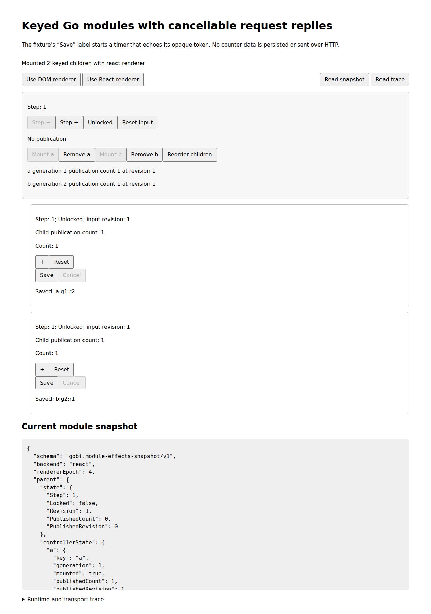

# Independently compiled keyed Go children with cancellable effects

Source: `e0933465725e470dc610e3f81b4bbee95538c1d0`. Review: [PR #23](https://github.com/samuelpmahan/gondola/pull/23), stacked on #22. Nothing merged to main or deployed.

Go owns each child’s count, key/generation identity, request ID, pending/reply state, reply-token validation and cancellation declarations. The existing counter, module child, keyed parent, Gobi nodes/messages/effects and typed module ABI are reused. The host routes the two closed effect descriptors and keeps transport correlation separate from renderer lifetime. The demo’s timer echoes an opaque token; it does not persist counter data or make an HTTP request.

## Reproduce from source

Use the exact source commit and locked dependencies. The root runtime uses Go 1.24.0 and Node 22.23.4; the compiler uses Go 1.27.3 with GoScript 0.6.2 and esbuild 0.28.2. React is pinned to 19.3.1. The executed browser is Chromium 153.0.8010.0 through Playwright 1.64.1; Python is 3.12.14 and GNU tar is 1.35.

```sh
git clone --single-branch --branch codex/gobi-keyed-module-effects-20261101 https://github.com/samuelpmahan/gondola.git
cd gondola
git checkout e0933465725e470dc610e3f81b4bbee95538c1d0
npm ci --no-audit --no-fund
npm ci --prefix interaction --no-audit --no-fund
npm ci --prefix compiled-frontend --no-audit --no-fund
CHROMIUM_PATH=/path/to/chromium bash run-module-effects.sh --source-commit e0933465725e470dc610e3f81b4bbee95538c1d0
```

`GOBI_GO_BIN`, `GOBI_NODE_BIN`, and `GOBI_PYTHON_BIN` select explicit installed tools. `--allow-dirty` is diagnostic only and does not qualify a clean run. Exact executed vectors, working directories, environment overrides, versions, stdout/stderr, source pins, captures and receipts are in `delivery-receipt.json` and the audit archive.

## Executable archived demonstration

The immutable raw directory is `https://raw.githubusercontent.com/samuelpmahan/gondola/3df075a3cee25498b144e0d166c71e841cda50af/compiled-module-effects/ci/2026-11-01/current`. Download `restore.py` there and verify SHA-256 `9340386d0726e957fc87153c372c67c9331d3e52ef863fdf07ace65c17ba7e98` before running it. Use new destination directories. The restore consumer checks all segment, manifest, member and source hashes, safe regular-file membership and gzip completion, then publishes atomically without overwriting; this implementation requires Linux `renameat2(RENAME_NOREPLACE)` and fails closed elsewhere.

```sh
curl -fL 'https://raw.githubusercontent.com/samuelpmahan/gondola/3df075a3cee25498b144e0d166c71e841cda50af/compiled-module-effects/ci/2026-11-01/current/restore.py' -o restore.py
printf '9340386d0726e957fc87153c372c67c9331d3e52ef863fdf07ace65c17ba7e98  restore.py\n' | sha256sum --check -
python3 restore.py /tmp/gobi-module-effects-demo --base-url 'https://raw.githubusercontent.com/samuelpmahan/gondola/3df075a3cee25498b144e0d166c71e841cda50af/compiled-module-effects/ci/2026-11-01/current'
python3 restore.py /tmp/gobi-module-effects-audit --audit --base-url 'https://raw.githubusercontent.com/samuelpmahan/gondola/3df075a3cee25498b144e0d166c71e841cda50af/compiled-module-effects/ci/2026-11-01/current'
python3 -m http.server 9000 --directory /tmp/gobi-module-effects-demo/demo/site
```

Open `http://localhost:9000/`. Add/reset counts, request/cancel token echoes, change React/DOM renderers while a timer is pending, and remove/remount keyed children. The packaged site is self-contained. Native scenario replay and direct/browser acceptance commands are in the independently reviewed `consume.py` and the E-CONSUME evidence packet.



## Executed evidence

| Check | Executed result |
| --- | --- |
| M0 static regression | 5,000 seeded inputs (`20261030`), 59 compatibility rules, original receipts unchanged |
| Existing counter | 107 scripts / 4,473 ticks, zero mismatches |
| Inherited keyed modules | 126 actions / 130 native checkpoints, 8 direct + 12 mounted profiles, 28 controls detected |
| New effects fixture | 178 native events / 182 checkpoints / 58 effects / 116 transport rows |
| New comparison matrix | 8 direct + 12 mounted profiles; 890 profile events / 910 snapshots matched |
| Fault evidence controls | 16 capture fault types × 4 scenarios = 64 detected applications; 7 build-admission faults detected |
| Profile Node suite | 36 tests in 7 files; zero failed or skipped |
| Focused Go checks | 13 native fixture/CLI tests, 1 ABI regression, 4 analyzer tests / 8 cases, 1 Build-stage regression |
| Full compiler Go suite | 82 passing terminal tests/subtests in 3 test-bearing packages; 5 packages with no tests; zero failed/skipped/cached results |
| Independent restored execution | 4 offline native replays and 8 extracted-source direct profiles, all byte and canonical-JSON equal |
| Actual archived browser demo | 6 steps / 12 `HTMLElement.click()` actions / 3 swaps / 2 timer replies / generation 1→2 remount; 4 local requests, 0 external requests/errors |
| Source binding | 430 distinct Git inputs verified; primary closure 202 files, including 58 test sources; full compiler's 203 inputs are a subset |
| Native coordination | 6 actual Luna 6 XHigh workers, 52 closed packets / 26 independent reviews, 62 exact-matching solver epochs, zero broken constraints |
| Published primary | 9 segments, 8,667,568 archive bytes, 639 members, 99,726,798 expanded bytes; fresh Git readback and restore passed |
| Hosted CI | 40 runs queued as of 2026-11-01 04:50:58 UTC; no claim that hosted CI is green |

The frozen action streams are literal (31 actions), seed 20261104 (49), seed 20261105 (50), and seed 20261106 (48). Across four scenarios, native Go has 178 events, 182 checkpoints, 58 effects and 116 transport rows. Each scenario is replayed as direct React, direct DOM, mounted React, mounted DOM and mounted renderer swap: 890 profile events and 910 snapshots. Exact traces record full Go state, Gobi trees, normalized mounted DOM, disabled controls, effect descriptors, correlation fields, lifecycle order and stale replies.

There are 16 saved-capture fault types applied separately to all four scenarios (64 applications), plus seven build-admission fault types. These controls mutate captured evidence; they are not live mounted fault injection. The mounted demo additionally observes actual committed Go pending state and rendered Save/Cancel controls before each transport start, timer completion across swaps, and Go unmount/commit/cancel before transport cancellation and renderer teardown. Browser actions use `HTMLElement.click()`, not trusted pointer/OS input.

M0 and the counter were executed in an isolated input-identical source copy; the inherited keyed regression ran in a clean detached checkout at `88e7937e66fd1c8f36e5b5dd3224209b07c6eb33`. Their exact input closures are separately bound to the final source commit. The new profile archive contains its compiler/test dependency closure, not a complete M0/counter checkout. Use the full Git checkout to rerun `bash run.sh`, `bash run-interaction.sh`, and `bash run-keyed-modules.sh`.

Original M0 receipts remain byte-identical: `EXPECTED.json` (320 bytes), SHA-256 `639e4327a927cadf3530d12d3c9a80bdd89ac329ae333261cecb90f66aa333d2`; `SHA256SUMS` (1,966 bytes), SHA-256 `8b6ec10d327152dc1d6b494223144b08dcf5c2f16bc80d53e9b059d1c9ffe1a0`.

## Review and provenance

Native Rebalancer 1.0.4 from toolkit PR1 head `989c295717511c812b69beda5d125817ffc054c9` allocated six actual Luna 6 workers at XHigh, within seven reported platform slots including the lead. Native solver recommendations and platform dispatch are distinct operations. Disjoint ownership, dependency gates, independent reviews, source snapshots, assignments, acceptance receipts, repair addenda and original failed attempts are inspectable in `coordination/` and the restored audit bundle. Idle workers are retained behind dependency gates rather than given fabricated work; one missed idle-worker wake and its explicit recovery are recorded.

The first clean source-88 aggregate failed after its producer completed all 20 profiles because the outer runner expected private stdout/stderr fields. The later clean source-f6 producer and archive passed, and an independent consumer replayed all four native traces and served its archived demo, but its relocated source loader still rejected the recorded absolute build root. That diagnostic archive and exact receipt are retained; the production loader repair and subsequent clean archive are separate checkpoints. Later author diagnostics exposed an unmount-order assertion selecting an unrelated earlier commit and a missing imported scenario constant. All available bytes from those three author attempts were materialized and hash-verified before audit publication. The final clean run and independent acceptance are separate evidence.

Known historical byte-retention limits include: the pre-extension E-DELIVERY diagnostics index and the exact runner body from failed author attempt `attempt-20261101T035129308Z-2-78bd7201`. Their absence is explicit; no reconstruction is claimed. Individual preserved logs, later source snapshots and the final qualification remain distinct. E-RUN’s stale Node subtotal (4 files/21 tests) is corrected by a separate immutable addendum to the retained full command’s 5 files/32 passes. Original frozen bytes remain preserved. An E-CONSUME working-copy metadata update arrived after sealing; both versions were retained, the canonical original was restored byte-for-byte, and the correct producer/source linkage is in `coordination/correction-E-CONSUME-producer-reference.json`. The clean producer command ledger also has eight streams without separate raw log files (their byte/hash records and parsed artifacts remain); the 38 materialized streams were independently rehashed.

## Guarantees and limits

The clean producer, independent archive consumer and their peer reviews passed for source `e0933465725e470dc610e3f81b4bbee95538c1d0` / tree `0a52ae23ab32e0ca35f6b1385ea851e3edeede3a`. [Delivery receipt](delivery-receipt.json), [independent acceptance](archive-acceptance.json), and the [frozen coordination acceptance](coordination/final-acceptance.json) record the distinct execution boundaries. The coordination snapshot predates the later Git publication checks by design.

Primary archive: **8,667,568 bytes**, SHA-256 `7eb9f28fc6504bf43207436dfc916549bb28e34059cee69bc138376be7940087`, nine segments, 639 members. Audit archive: **140,985,501 bytes**, SHA-256 `46f42cfa046788da22f6866b58d70c8208be20eb2ce86d4d5e122350051de083`, 135 segments, 6,133 members / 1,186,985,053 expanded bytes. The audit is optional for running the demo and contains the detailed raw history.

Fresh Git readback verified all **661 payload files** at immutable publication commit `3df075a3cee25498b144e0d166c71e841cda50af`, plus all 202 primary source pins against the source Git commit; changes outside the evidence prefix were absent. Both archives were restored from those actual Git bytes. The [published-byte proof](github-readback.json), [read-only verifier](consume.py), and [expected payload inventory](expected-publication.json) are added by a final finite proof commit. That proof targets the immutable payload commit; subsequent guide/proof files are checked separately to avoid a self-referential receipt.

Demonstrated equivalence is bounded to the recorded fixed `a`/`b` keyed fixtures, action streams, closed opaque-token effect descriptors, emitted Go subset and pinned React/DOM/Chromium implementations. Other browser engines, arbitrary Go or module graphs, HTTP/persistence, trusted input, IME, hydration, concurrent React, pixels and resistance to fabricated evidence remain untested. The consumer’s illustrative screenshot does not establish pixel equivalence. SHA-256 pins establish byte consistency, not publisher authenticity.

Another frontend backend must implement the typed module/helper/renderer roles, preserve the declared Go value semantics, expose Gobi tree/DOM/callback captures, admit the exact effect capabilities and descriptors, keep request correlation independent from renderer epochs, obey commit/start/cancel/teardown order, and pass the same native/direct/mounted replay and negative controls. No additional frontend backend is qualified by this milestone.

Next substantial milestone: extend native Go qualification to these asynchronous keyed-module traces, with live transport-fault tests and explicit typed error/timeout results rather than only an opaque token echo.
